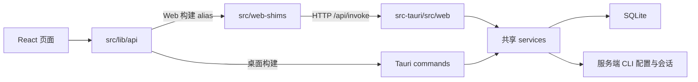

# 参与 cc-switch-headless / Contributing

本 fork 维护 CC Switch 的无头 Web 服务端，复用上游的前端与业务服务。Web 问题、部署文档和 HTTP 适配提交到本仓库；通用 CLI 业务改动请注明是否也适合提交上游。

请先阅读 [行为准则](CODE_OF_CONDUCT.md)。漏洞按 [安全策略](SECURITY.md) 私密报告；普通问题使用本仓库的 [Issue 模板](https://github.com/zhangzhiwei-zzw/cc-switch-headless/issues/new/choose)。

## 1. Web 开发环境

- Node.js：跟随 `.node-version`；支持的最低版本见 `package.json` 所用 Vite 的要求。
- pnpm：使用 `package.json` 的 `packageManager` 固定版本，通过 `corepack enable` 启用。
- Rust：通过 rustup 安装，版本和组件跟随 `rust-toolchain.toml`。
- Linux 源码构建需要 C/C++ 构建工具、pkg-config；Windows 需要 MSVC Build Tools。**仅构建 server 不需要 GTK、WebKit 或 Tauri 的桌面系统库**。
- HTTP 回归依赖 Bash、curl、Python 3，在 Linux 或 WSL 运行；浏览器回归使用 Playwright Chromium。

从仓库根目录执行：

```bash
corepack enable
pnpm install --frozen-lockfile
pnpm build:web
cargo build --manifest-path src-tauri/Cargo.toml --no-default-features --features server --bin cc-switch-server
./src-tauri/target/debug/cc-switch-server
```

Windows 最后一行改为 `./src-tauri/target/debug/cc-switch-server.exe`。访问启动日志给出的登录链接，或在登录页输入访问令牌。

第二个终端运行 `pnpm dev:web` 使用热更新，API 默认代理到 `127.0.0.1:15800`。这些操作会读取服务进程所在用户的真实 CLI 配置；开发时可使用独立的系统用户或容器。`CC_SWITCH_CONFIG_DIR` 只隔离 CC Switch 数据，不能代替各 CLI 配置的隔离。

## 2. 代码在哪里



- `src/lib/api/commandSchemas.ts`：关键命令的参数、返回值和 Web 响应信封契约。
- `src/web-shims/command-contract.json`：已支持、浏览器适配与未支持命令的分类及能力声明。
- `src-tauri/src/web/`：认证、HTTP 适配和事件流；业务逻辑放到共享 `services/`。
- `src/web-shims/app-support.json`：用户支持表的说明数据。
- `scripts/web/`：命令覆盖、契约与文档一致性检查。
- `scripts/e2e/`、`tests/browser/`：临时配置下的 HTTP 回归与真实浏览器回归。

新增或改动接口，按 [Web 接口契约指南](docs/web-api-contract.md) 完成注册、类型、能力声明和文档。不要用空实现、固定成功值或泛化的 `allow(dead_code)` 掩盖未接入功能。

## 3. 本地检查

按改动范围运行以下检查，并在 PR 中写明实际执行结果；未运行的项目说明原因。

| 改动 | 检查 |
| --- | --- |
| 前端代码 | `pnpm typecheck`、`pnpm format:check`、相关 `pnpm exec vitest run <文件>` |
| 命令、能力、支持表或对应文档 | `pnpm check:web` |
| Web 页面或 shim | `pnpm build:web`、相关浏览器回归 |
| Rust 共享代码 | `cargo fmt --manifest-path src-tauri/Cargo.toml --check`，以及 desktop/server 两种 feature 的 Clippy |
| HTTP 路由、持久化、安全边界 | server 构建和相关 HTTP 回归 |
| 纯文档 | 检查链接、命令的工作目录、功能与支持表是否一致 |

Web/server 的完整命令从仓库根目录执行：

```bash
pnpm check:web
pnpm typecheck
pnpm format:check
pnpm build:web
cargo fmt --manifest-path src-tauri/Cargo.toml --check
cargo clippy --manifest-path src-tauri/Cargo.toml --no-default-features --features server --bin cc-switch-server -- -D warnings
cargo build --manifest-path src-tauri/Cargo.toml --no-default-features --features server --bin cc-switch-server
bash scripts/e2e/run-all.sh
pnpm exec playwright install chromium --only-shell
pnpm test:web
```

`pnpm check:web` 包含覆盖检查器自身的 Node 测试。只查看静态结果时，可分别运行 `node scripts/web/check-command-coverage.mjs`、`node scripts/web/check-rpc-contract.mjs`、`node scripts/web/generate-capabilities.mjs --check`。

共享 Rust 代码还需在安装好桌面系统依赖后运行默认 feature 的 Clippy。CI 桌面测试使用 `cargo nextest run --manifest-path src-tauri/Cargo.toml --profile ci`；本地也可用 `cargo test`。具体依赖、测试隔离与桌面构建见 [桌面开发参考](docs/contributing-desktop.md)。不要同时运行多个大型 Rust 链接任务。

## 4. 修改文档与文案

- 用户能力说明更新 `app-support.json`，能力分类更新 `command-contract.json`，然后运行 `node scripts/web/generate-capabilities.mjs`；不要手改生成的两个支持表。
- 部署行为变化要同步 [部署说明](docs/web-mode-zh.md) 和 [排错指南](docs/web-troubleshooting.md)。
- 界面文案使用 i18next，更新 zh、zh-TW、en、ja；tr 是社区翻译，可以回退到英文。不要翻译命令名、路径或 `{{变量}}`。
- 提交错误日志前移除令牌、API Key、会话正文与私人路径。

## 5. Pull Request

1. 从 main 创建分支；涉及新功能或行为改变时，先用 Issue 说明场景。
2. 一个 PR 聚焦一个主题；注明是否影响桌面和 server 两种构建。
3. 填写 PR 模板，给出复现/验证步骤；UI 改动附截图。
4. 上游同步使用 merge；遵循 [同步流程](docs/syncing-upstream-zh.md)，保留本 fork 的 feature 门与发布策略。

提交信息使用 `fix(web): ...`、`feat(server): ...`、`docs(web): ...` 等形式。AI 辅助提交也须由提交者阅读并承担维护责任，不提交未经理解的批量改动。

## English quick reference

This fork maintains the headless Web runtime. Build with `pnpm build:web` and `cargo build --manifest-path src-tauri/Cargo.toml --no-default-features --features server --bin cc-switch-server`, then run the server. Use `pnpm dev:web` in a second terminal for hot reload. Server-only builds do not require GTK/WebKit; desktop prerequisites are in the [desktop reference](docs/contributing-desktop.md).

Browser actions affect the **server user's** CLI files. `CC_SWITCH_CONFIG_DIR` isolates the CC Switch database, not every CLI directory. Use an isolated user/container for development that writes live configurations.

Keep business rules in shared services. For a new command, register its HTTP handler, classify capabilities, add typed request/result schemas for critical flows and update generated support documentation. See the [API contract guide](docs/web-api-contract.md). Document executed checks in your PR, report security issues privately, and redact credentials from diagnostics.
